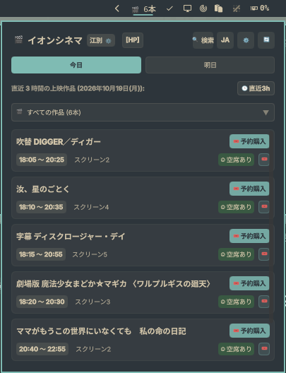
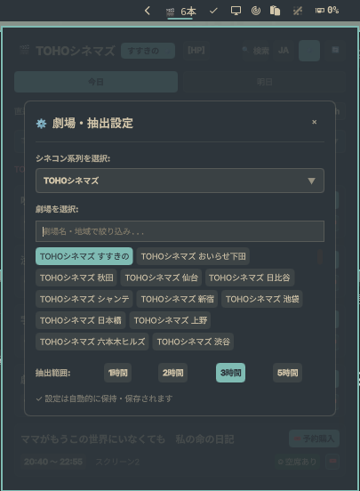
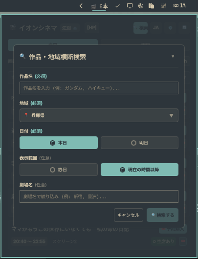

# Cinecom Scheduler

A native Omarchy / Quickshell bar widget and lightweight Python scraper for Cinema Complex schedules, screen facilities, and seat bookings across Japan (**Aeon Cinema**, **TOHO Cinemas**, **United Cinemas**, & **Cinema Sunshine**).

Plugin ID: `com.yusuke.cinecom-scheduler`.

イオンシネマ（全国99劇場）、TOHOシネマズ（全国74劇場）、ユナイテッド・シネマ（全国40劇場）、シネマサンシャイン（全国16劇場、計229劇場）の上映スケジュール、空席状況、スクリーン設備情報（IMAX / Dolby Atmos / 4DX / ScreenX 等）、座席予約購入リンクを表示する Omarchy デスクトップ向けバーウィジェットおよび Python CLI ツールです。外部依存ライブラリなし（Python 標準ライブラリのみ）で高速・軽量に動作します。

## Preview



<p align="center">
  
  
</p>

## Usage

- **バーウィジェット**: クリックで上映スケジュールパネルを開きます。外側をクリックするか再度クリックで閉じます。
- **系列・劇場の切り替え**: パネル上部の劇場名または「⚙」アイコンをクリックして設定モーダルを開き、4大シネコン系列（イオン / TOHO / ユナイテッド / サンシャイン）および全国229劇場をインクリメンタル検索で切り替え可能です。
- **直近上映 / 終日表示**: 今日の上映について、直近指定時間（1h, 2h, 3h, 5h）以内の絞り込み表示と、1日の全上映を時系列で確認できる終日表示をワンクリックで切り替えられます。
- **明日の上映確認**: 「明日」タブを選択することで、翌日の全上映回を即座に確認できます。
- **作品絞り込み**: 閲覧中の劇場で上映されている作品名ドロップダウンから特定の作品のみを抽出できます。
- **スクリーン設備詳細**: 各上映回のスクリーン名（`スクリーン1`、`SCREEN 7` など）をクリックすると、IMAX / 4DX / Dolby Atmos などの設備仕様、座席内訳（一般・車椅子・プレミアム）、公式座席表リンクがモーダル表示されます。
- **地域×作品名の横断検索**: ヘッダーの「🔍 検索」ボタンから、都道府県やエリア（例: `東京都`）と作品名を指定して、系列を横断した上映タイムラインを一括比較できます。
- **設定の永続化**: 選択したシネコン系列、劇場、時間枠、言語設定（JA / EN）は Omarchy のネイティブ設定 API を通じて `~/.config/omarchy/shell.json` に自動保存され、再起動後も保持されます。

## Data sources and limitations

Python 3 の標準ライブラリのみを使用し、外部 pip パッケージのインストールや管理者特権は不要です。

- **取得データ**: 各シネコンの公式サイトより、最新の上映スケジュール、上映開始・終了時刻、空席ステータス、チケット予約購入リンクを取得します。
- **安全性**: 外部から受け取ったすべてのURLやIDはセキュリティサニタイザーおよびドメインホワイトリストで厳格に検証・エスケープされます。QML UI 上でのプレーンテキスト強制により安全に描画されます。

## Management and diagnostics

```sh
omarchy plugin validate ~/.config/omarchy/plugins/com.yusuke.cinecom-scheduler
omarchy plugin enable com.yusuke.cinecom-scheduler
omarchy plugin disable com.yusuke.cinecom-scheduler
```

単体テストの実行:

```sh
python3 -m unittest discover tests
```

## Install and remove

Omarchy Quattro および Python 3（標準ライブラリのみ）で動作します。追加のインストーラーやバックグラウンドサービスは不要です。

```sh
omarchy plugin add https://github.com/yuskesuzki/cinecom-scheduler-plugin.git --enable
omarchy plugin disable com.yusuke.cinecom-scheduler
omarchy plugin remove com.yusuke.cinecom-scheduler
```

プラグインの削除によってユーザー固有の他の設定ファイルが破損・変更されることはありません。

QML バリデーションの実行:

```sh
omarchy plugin validate .
```

---

## 主な特徴

- **4大シネコン系列対応（Providerアーキテクチャ）**:
  - 🍿 **イオンシネマ**（全99劇場）: 残席数、アップグレードシート・設備情報、公式作品・予約リンク
  - 🎬 **TOHOシネマズ**（全74劇場）: 空席ステータス（◎空席あり / △残少 / ✕満席）、TCX・轟音・IMAX設備、公式作品・予約リンク
  - 🎟️ **ユナイテッド・シネマ**（全40劇場）: 空席ステータス、4DX・IMAX・ScreenXタグ、公式作品・購入リンク
  - ☀️ **シネマサンシャイン**（全16劇場）: 空席ステータス、IMAXレーザー・BESTIA・4DX設備、公式作品・購入リンク
- **地域×作品名のシネコン横断上映検索**:
  - 都道府県（例: `東京都`）やエリアと作品名を指定して、複数系列の劇場上映回をタイムライン形式（上映開始時刻順）で一括比較。
  - 劇場名での絞り込み（`--theater`）や、指定時刻・現在時刻以降の絞り込み（`--after now`）にも対応。
- **コンポーネント化されたモダンな QML UI**:
  - バーウィジェット本体と各ビュー（`MovieScheduleView`, `SearchModal`, `SearchResultView`, `ScreenModal`, `SettingsModal`）が独立して整理され、軽量かつ高速に動作。
  - シネコン系列・劇場切り替え、インクリメンタル検索、上映日付ナビゲーション完備。
- **スクリーン設備詳細モーダル**:
  - IMAX、Dolby Cinema、4DX、ScreenX などの設備バッジ、座席内訳（一般席/プレミアム席/車椅子席）、公式座席表リンクをモーダル表示。
- **直近時間フィルター & 明日の上映確認**:
  - 今日: 現在時刻から指定時間以内（1h, 2h, 3h, 5h）に上映開始する作品を動的抽出
  - 明日: 明日の全上映作品一覧（`YYYY年MM月DD日(曜日)`）を表示
- **軽量 & 高速**: 外部ライブラリ不要（Python 3.9以上の標準ライブラリのみで動作）。
- **安全な設計**:
  - セキュリティサニタイザー（外部APIから受け取ったIDやURLの安全性を検証・エスケープ）を完備。
  - QML表示時のプレーンテキスト強制および安全な外部リンクハンドリング。

---

## ディレクトリ構成

```text
cinecom-scheduler-plugin/
├── BarWidget.qml              # Omarchy 用 UI ウィジェット (QML)
├── manifest.json              # Omarchy プラグイン定義
├── components/                # 分割された QML コンポーネント群
│   ├── MovieScheduleView.qml  # 単一劇場スケジュール表示ビュー
│   ├── ScreenModal.qml        # スクリーン設備・座席詳細モーダル
│   ├── SearchModal.qml        # 作品×地域横断検索モーダル
│   ├── SearchResultView.qml   # 横断検索結果タイムライン表示ビュー
│   └── SettingsModal.qml      # 系列・劇場・時間範囲設定モーダル
├── data/
│   ├── chains.json            # 系列定義 (aeon, toho, united, sunshine)
│   ├── theaters.json          # 全シネコン統合劇場マスタ (計229館)
│   └── theaters/              # 系列別劇場マスタ (aeon, toho, united, sunshine)
├── scraper/                   # バックエンド Python パッケージ
│   ├── __init__.py
│   ├── area.py                # 都道府県・地方エリア正規化マッパー
│   ├── cli.py                 # 統合CLI (python3 -m scraper.cli)
│   ├── models.py              # 共通データモデル (ScheduleResponse, Movie, Screening 等)
│   ├── sanitizer.py           # 安全なURL検証・サニタイズ
│   ├── search.py              # 地域×作品名横断検索オーケストレーター
│   └── providers/             # 各シネコン向け Provider
│       ├── __init__.py        # PROVIDER_REGISTRY
│       ├── base.py            # BaseCinemaProvider (基底クラス)
│       ├── aeon.py            # AeonCinemaProvider
│       ├── sunshine.py        # CinemaSunshineProvider
│       ├── toho.py            # TohoCinemaProvider
│       └── united.py          # UnitedCinemaProvider
├── tests/                     # ユニットテスト (全30テスト完備)
│   ├── test_scraper.py        # 各Provider・スクレイパーテスト
│   ├── test_search.py         # 横断検索・エリアマッパーテスト
│   └── test_ui.py             # UIコンポーネント・構文検証テスト
└── pyproject.toml
```

---

## CLI の使い方

プラグインのバックエンドスクレイパーは、ターミナルから単体でも実行できます。

### 1. 単一劇場のスケジュール取得 (`--mode theater`)

#### イオンシネマ
```bash
# デフォルト (イオンシネマ 江別)
python3 -m scraper.cli --chain aeon --theater ebetsu

# 指定日付・コンパクトJSON出力
python3 -m scraper.cli --chain aeon --theater ebetsu --date 2026-10-20 --compact
```

#### TOHOシネマズ
```bash
# TOHOシネマズ すすきの
python3 -m scraper.cli --chain toho --theater 089

# TOHOシネマズ 日比谷
python3 -m scraper.cli --chain toho --theater 081 --date 2026-10-20
```

#### ユナイテッド・シネマ
```bash
# ローソン・ユナイテッドシネマ 札幌
python3 -m scraper.cli --chain united --theater sapporo

# ユナイテッド・シネマ 豊洲
python3 -m scraper.cli --chain united --theater toyosu --date 2026-10-20
```

#### シネマサンシャイン
```bash
# グランドシネマサンシャイン 池袋
python3 -m scraper.cli --chain sunshine --theater gdcs

# シネマサンシャイン 平和島
python3 -m scraper.cli --chain sunshine --theater heiwajima --date 2026-10-20
```

---

### 2. 地域×作品名のシネコン横断検索 (`--mode search`)

複数シネコン系列を横断し、指定地域・作品の上映回を開始時刻順に一括取得します。

```bash
# 東京都内の劇場から作品を検索
python3 -m scraper.cli --mode search --area "東京都" --title "バイオハザード"

# 日付指定および現在時刻以降の回に絞り込み
python3 -m scraper.cli --mode search --area "東京都" --title "バイオハザード" --date 2026-10-20 --after now

# 特定の劇場名（例: 新宿）のみに絞り込み
python3 -m scraper.cli --mode search --area "東京都" --title "バイオハザード" --theater "新宿"
```

---

## テストの実行

```bash
python3 -m unittest discover tests
```

---

## ライセンス

MIT License
